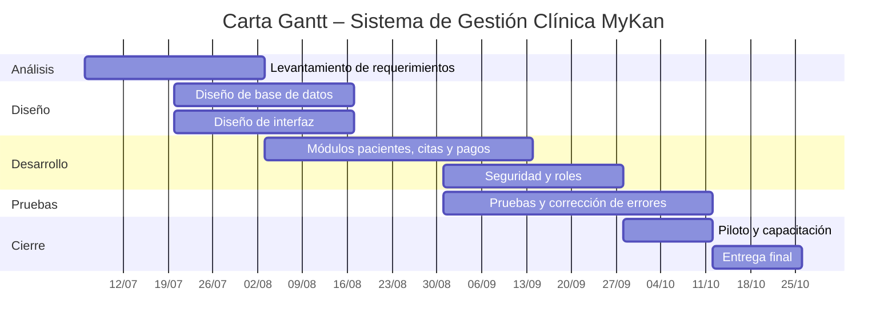

# Planificación del proyecto – MyKan

**Proyecto:** Sistema de Gestión de Citas – Clínica Veterinaria MyKan
**Duración:** 16 semanas (julio a octubre de 2026)

| # | Actividad | Responsable | Semanas | Fechas |
|---|---|---|---|---|
| 1 | Levantamiento de requerimientos | Paulina Andrade (Project Manager) | 1–4 | 06/07 – 02/08 |
| 2 | Diseño de base de datos | Juan Carlos Ramírez (Analista BD) | 3–6 | 20/07 – 16/08 |
| 3 | Diseño de interfaz | Camilo Gatica (Diseñador) | 3–6 | 20/07 – 16/08 |
| 4 | Desarrollo módulos pacientes, citas y pagos | Benjamín Monsálves (Desarrollador) | 5–10 | 03/08 – 13/09 |
| 5 | Seguridad y roles | Benjamín Monsálves (Desarrollador) | 9–12 | 31/08 – 27/09 |
| 6 | Pruebas y corrección de errores | Equipo completo | 9–14 | 31/08 – 11/10 |
| 7 | Implementación piloto y capacitación | Paulina Andrade / Edgard Luna (Product Manager) | 13–14 | 28/09 – 11/10 |
| 8 | Entrega final | Equipo completo | 15–16 | 12/10 – 25/10 |
