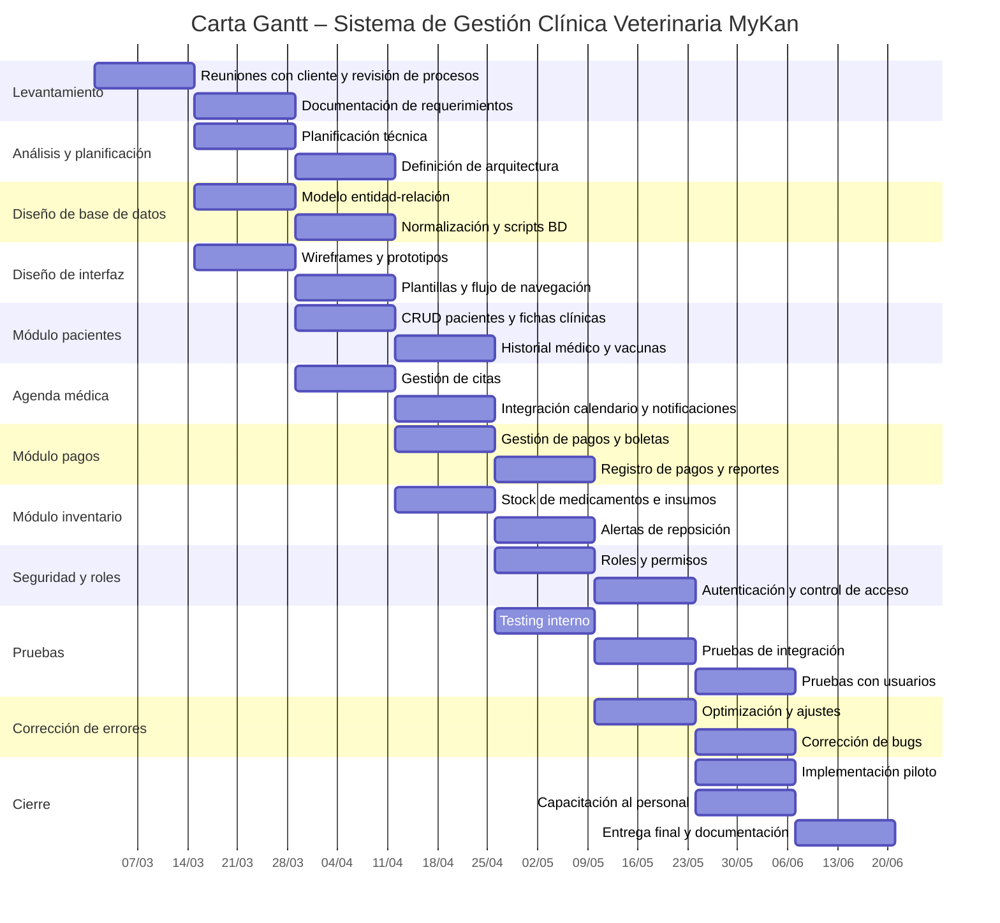

# Planificación del proyecto – MyKan

**Proyecto:** Sistema de Gestión de Citas – Clínica Veterinaria MyKan
**Equipo:** PentaSolutions
**Duración:** 16 semanas (1 de marzo al 20 de junio de 2027)

## Carta Gantt

## Detalle de actividades

| Fase | Actividad | Responsable | Semanas | Fechas |
|---|---|---|---|---|
| Levantamiento | Reuniones con cliente y revisión de procesos clínicos | Paulina Andrade (Project Manager) | 1–2 | 01/03 – 14/03 |
| Levantamiento | Documentación de requerimientos | Juan Carlos Ramírez (Analista BD) | 3–4 | 15/03 – 28/03 |
| Análisis | Planificación técnica | Paulina Andrade (Project Manager) | 3–4 | 15/03 – 28/03 |
| Análisis | Definición de arquitectura | Juan Carlos Ramírez / Benjamín Monsálves | 5–6 | 29/03 – 11/04 |
| Diseño BD | Modelo entidad-relación | Juan Carlos Ramírez (Analista BD) | 3–4 | 15/03 – 28/03 |
| Diseño BD | Normalización y scripts BD | Juan Carlos Ramírez (Analista BD) | 5–6 | 29/03 – 11/04 |
| Diseño interfaz | Wireframes y prototipos | Camilo Gatica (Diseñador) | 3–4 | 15/03 – 28/03 |
| Diseño interfaz | Plantillas y flujo de navegación | Camilo Gatica (Diseñador) | 5–6 | 29/03 – 11/04 |
| Pacientes | CRUD pacientes y fichas clínicas | Benjamín Monsálves (Desarrollador) | 5–6 | 29/03 – 11/04 |
| Pacientes | Historial médico y vacunas | Benjamín Monsálves (Desarrollador) | 7–8 | 12/04 – 25/04 |
| Agenda | Gestión de citas | Benjamín Monsálves (Desarrollador) | 5–6 | 29/03 – 11/04 |
| Agenda | Integración calendario y notificaciones | Benjamín Monsálves (Desarrollador) | 7–8 | 12/04 – 25/04 |
| Pagos | Gestión de pagos y boletas | Benjamín Monsálves (Desarrollador) | 7–8 | 12/04 – 25/04 |
| Pagos | Registro de pagos y reportes | Benjamín Monsálves / Juan Carlos Ramírez | 9–10 | 26/04 – 09/05 |
| Inventario | Stock de medicamentos e insumos | Benjamín Monsálves (Desarrollador) | 7–8 | 12/04 – 25/04 |
| Inventario | Alertas de reposición | Benjamín Monsálves (Desarrollador) | 9–10 | 26/04 – 09/05 |
| Seguridad | Roles y permisos | Benjamín Monsálves (Desarrollador) | 9–10 | 26/04 – 09/05 |
| Seguridad | Autenticación y control de acceso | Benjamín Monsálves (Desarrollador) | 11–12 | 10/05 – 23/05 |
| Pruebas | Testing interno | Equipo completo | 9–10 | 26/04 – 09/05 |
| Pruebas | Pruebas de integración | Equipo completo | 11–12 | 10/05 – 23/05 |
| Pruebas | Pruebas con usuarios | Edgard Luna (Product Manager) | 13–14 | 24/05 – 06/06 |
| Corrección | Optimización y ajustes | Benjamín Monsálves (Desarrollador) | 11–12 | 10/05 – 23/05 |
| Corrección | Corrección de bugs | Benjamín Monsálves (Desarrollador) | 13–14 | 24/05 – 06/06 |
| Cierre | Implementación piloto | Paulina Andrade (Project Manager) | 13–14 | 24/05 – 06/06 |
| Cierre | Capacitación al personal | Edgard Luna (Product Manager) | 13–14 | 24/05 – 06/06 |
| Cierre | Entrega final y documentación | Equipo completo | 15–16 | 07/06 – 20/06 |

## Hitos importantes

| Hito | Semana | Fecha | Responsable |
|---|---|---|---|
| Inicio del proyecto | 1–2 | 01/03/2027 | Project Manager |
| Finalización del análisis | 3–4 | 28/03/2027 | Analista Base de Datos |
| Diseño del sistema | 5–6 | 11/04/2027 | Diseñador |
| Desarrollo módulo de pacientes | 5–6 | 11/04/2027 | Desarrollador |
| Desarrollo módulo de turnos | 7–8 | 25/04/2027 | Desarrollador |
| Pruebas del sistema | 11–12 | 23/05/2027 | Equipo completo |
| Implementación piloto y capacitación | 13–14 | 06/06/2027 | Project Manager / Product Manager |
| Entrega final | 15–16 | 20/06/2027 | Equipo completo |
