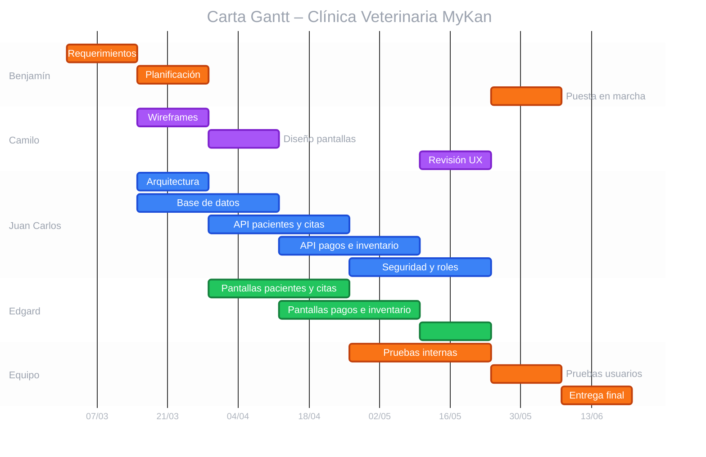

# Planificación del proyecto – MyKan

**Proyecto:** Sistema de Gestión de Citas – Clínica Veterinaria MyKan
**Equipo:** PentaSolutions
**Duración:** 16 semanas (1 de marzo al 20 de junio de 2027)

## Carta Gantt

**Leyenda:** 🟠 Benjamín (Líder) y equipo completo · 🟣 Camilo (Diseñador) · 🔵 Juan Carlos (Backend) · 🟢 Edgard (Frontend)

## Detalle de actividades

| Fase | Actividad | Responsable | Semanas | Fechas |
|---|---|---|---|---|
| Planificación | Reuniones con cliente y levantamiento de requerimientos | Benjamín (Líder) | 1–2 | 01/03 – 14/03 |
| Planificación | Planificación técnica y seguimiento del proyecto | Benjamín (Líder) | 3–4 | 15/03 – 28/03 |
| Planificación | Definición de arquitectura | Juan Carlos (Backend) | 3–4 | 15/03 – 28/03 |
| Diseño | Modelo de datos y scripts de base de datos | Juan Carlos (Backend) | 3–6 | 15/03 – 11/04 |
| Diseño | Wireframes y prototipos | Camilo (Diseñador) | 3–4 | 15/03 – 28/03 |
| Diseño | Diseño de pantallas y flujo de navegación | Camilo (Diseñador) | 5–6 | 29/03 – 11/04 |
| Desarrollo | API de pacientes y agenda de citas | Juan Carlos (Backend) | 5–8 | 29/03 – 25/04 |
| Desarrollo | Pantallas de pacientes y agenda de citas | Edgard (Frontend) | 5–8 | 29/03 – 25/04 |
| Desarrollo | API de pagos e inventario | Juan Carlos (Backend) | 7–10 | 12/04 – 09/05 |
| Desarrollo | Pantallas de pagos e inventario | Edgard (Frontend) | 7–10 | 12/04 – 09/05 |
| Desarrollo | Seguridad, roles y autenticación | Juan Carlos (Backend) | 9–12 | 26/04 – 23/05 |
| Desarrollo | Pantalla de login y ajustes de interfaz | Edgard (Frontend) | 11–12 | 10/05 – 23/05 |
| Desarrollo | Revisión de experiencia de usuario (UX) | Camilo (Diseñador) | 11–12 | 10/05 – 23/05 |
| Pruebas | Pruebas internas y de integración | Equipo completo | 9–12 | 26/04 – 23/05 |
| Pruebas | Pruebas con usuarios y corrección de errores | Equipo completo | 13–14 | 24/05 – 06/06 |
| Cierre | Implementación piloto y capacitación | Benjamín (Líder) | 13–14 | 24/05 – 06/06 |
| Cierre | Entrega final y documentación | Equipo completo | 15–16 | 07/06 – 20/06 |

## Hitos

| Hito | Fecha | Responsable |
|---|---|---|
| Requerimientos aprobados | 28/03/2027 | Benjamín (Líder) |
| Diseño del sistema terminado | 11/04/2027 | Camilo (Diseñador) |
| Módulos principales desarrollados | 09/05/2027 | Juan Carlos / Edgard |
| Sistema probado | 06/06/2027 | Equipo completo |
| Entrega final | 20/06/2027 | Equipo completo |
