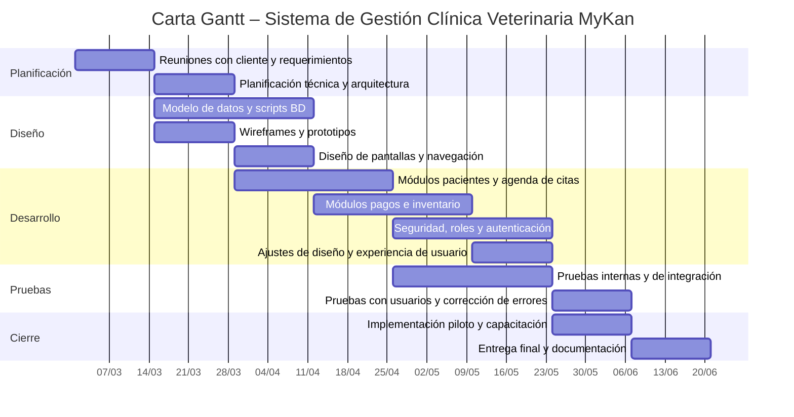

# Planificación del proyecto – MyKan

**Proyecto:** Sistema de Gestión de Citas – Clínica Veterinaria MyKan
**Equipo:** PentaSolutions
**Duración:** 16 semanas (1 de marzo al 20 de junio de 2027)

## Equipo

| Integrante | Rol |
|---|---|
| Benjamín Monsálves | Líder de proyecto |
| Camilo Gatica | Diseñador |
| Juan Carlos Ramírez | Backend |
| Edgard Luna | Frontend |

## Carta Gantt

## Detalle de actividades

| # | Actividad | Responsable | Semanas | Fechas |
|---|---|---|---|---|
| 1 | Reuniones con cliente y levantamiento de requerimientos | Benjamín (Líder) | 1–2 | 01/03 – 14/03 |
| 2 | Planificación técnica y definición de arquitectura | Benjamín / Juan Carlos | 3–4 | 15/03 – 28/03 |
| 3 | Modelo de datos y scripts de base de datos | Juan Carlos (Backend) | 3–6 | 15/03 – 11/04 |
| 4 | Wireframes y prototipos | Camilo (Diseñador) | 3–4 | 15/03 – 28/03 |
| 5 | Diseño de pantallas y flujo de navegación | Camilo (Diseñador) | 5–6 | 29/03 – 11/04 |
| 6 | Módulos de pacientes y agenda de citas | Juan Carlos / Edgard | 5–8 | 29/03 – 25/04 |
| 7 | Módulos de pagos e inventario | Juan Carlos / Edgard | 7–10 | 12/04 – 09/05 |
| 8 | Seguridad, roles y autenticación | Juan Carlos (Backend) | 9–12 | 26/04 – 23/05 |
| 9 | Ajustes de diseño y experiencia de usuario | Camilo / Edgard | 11–12 | 10/05 – 23/05 |
| 10 | Pruebas internas y de integración | Equipo completo | 9–12 | 26/04 – 23/05 |
| 11 | Pruebas con usuarios y corrección de errores | Equipo completo | 13–14 | 24/05 – 06/06 |
| 12 | Implementación piloto y capacitación | Benjamín (Líder) | 13–14 | 24/05 – 06/06 |
| 13 | Entrega final y documentación | Equipo completo | 15–16 | 07/06 – 20/06 |

## Hitos

| Hito | Fecha | Responsable |
|---|---|---|
| Requerimientos aprobados | 28/03/2027 | Benjamín (Líder) |
| Diseño del sistema terminado | 11/04/2027 | Camilo (Diseñador) |
| Módulos principales desarrollados | 09/05/2027 | Juan Carlos / Edgard |
| Sistema probado | 06/06/2027 | Equipo completo |
| Entrega final | 20/06/2027 | Equipo completo |
